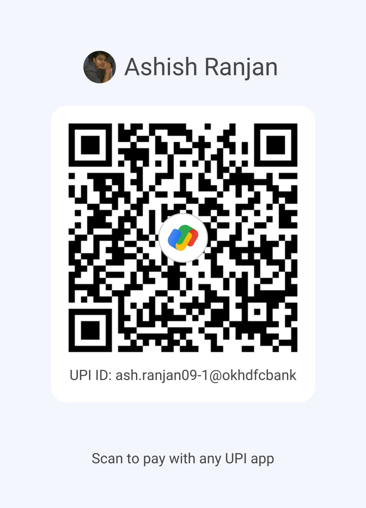

# Ashish Ranjan

**Full-Stack Developer**

I build practical React apps and secure APIs with Node.js, Express, and MongoDB. Based in Bengaluru, India; always learning.

<table width="100%">
  <tr>
    <td width="58%" valign="top">
      <h2>Connect</h2>
      <table width="100%">
        <thead>
          <tr><th>Link</th><th>Destination</th></tr>
        </thead>
        <tbody>
          <tr><td>🌐 Portfolio</td><td><a href="https://www.ashishranjan.net/">ashishranjan.net</a></td></tr>
          <tr><td>🐙 GitHub</td><td><a href="https://github.com/a2rp">github.com/a2rp</a></td></tr>
          <tr><td>📂 Public repositories</td><td><a href="https://github.com/a2rp?tab=repositories">Browse repositories</a></td></tr>
          <tr><td>📄 Resume</td><td><a href="https://a2rp.github.io/resume/">Resume website</a></td></tr>
          <tr><td>💼 LinkedIn</td><td><a href="https://www.linkedin.com/in/aashishranjan">linkedin.com/in/aashishranjan</a></td></tr>
          <tr><td>📘 Facebook</td><td><a href="https://www.facebook.com/theash.ashish/">facebook.com/theash.ashish</a></td></tr>
          <tr><td>▶️ YouTube</td><td><a href="https://www.youtube.com/@ashishranjan-ashz">youtube.com/@ashishranjan-ashz</a></td></tr>
          <tr><td>🖋️ CodePen</td><td><a href="https://codepen.io/ash1198">codepen.io/ash1198</a></td></tr>
          <tr><td>✉️ Email</td><td><a href="mailto:ash.ranjan09@gmail.com">ash.ranjan09@gmail.com</a></td></tr>
        </tbody>
      </table>
    </td>
    <td width="42%" valign="top">
      <h2>Support</h2>
      <table width="100%">
        <thead>
          <tr><th>Option</th><th>Link</th></tr>
        </thead>
        <tbody>
          <tr><td>❤️ Support page</td><td><a href="https://a2rp-donation-page.netlify.app/">Visit support page</a></td></tr>
          <tr><td>☕ Buy Me a Coffee</td><td><a href="https://buymeacoffee.com/a2rp">buymeacoffee.com/a2rp</a></td></tr>
          <tr><td>🎗️ Patreon</td><td><a href="https://www.patreon.com/a2rp">patreon.com/a2rp</a></td></tr>
        </tbody>
      </table>
      <h3>UPI</h3>
      
      
<strong>UPI ID:</strong> <code>ash.ranjan09-1@okhdfcbank</code>

    </td>
  </tr>
</table>
